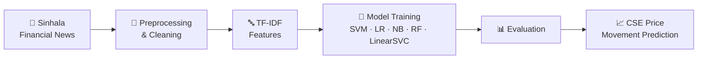

<a id="top"></a>

<!-- ═══════════════════════════ HEADER ═══════════════════════════ -->


<div align="center">

<a href="https://huzaifa-ameer.vercel.app/">
  
</a>

<br/>

<a href="https://huzaifa-ameer.vercel.app/"></a>
<a href="https://www.linkedin.com/in/huzaifa-ameer-28a126253"></a>
<a href="https://medium.com/@huzaifaameer00"></a>
<a href="https://sollydlabs.com/"></a>

<br/>


<br/><br/>

<b>
<a href="#about">About</a> &nbsp;·&nbsp;
<a href="#sollyd-labs">Sollyd Labs</a> &nbsp;·&nbsp;
<a href="#research">Research</a> &nbsp;·&nbsp;
<a href="#experience">Experience</a> &nbsp;·&nbsp;
<a href="#tech-stack">Tech Stack</a> &nbsp;·&nbsp;
<a href="#projects">Projects</a> &nbsp;·&nbsp;
<a href="#writing">Writing</a> &nbsp;·&nbsp;
<a href="#contact">Contact</a>
</b>

</div>

<br/>

<!-- ═══════════════════════════ ABOUT ═══════════════════════════ -->

<a id="about"></a>

##  About Me

<table>
<tr>
<td width="60%" valign="top">

I'm a **Computer Science graduate with First Class Honours** and the **co-founder of [Sollyd Labs](https://sollydlabs.com/)**. I love building practical software products, exploring AI & machine learning, and engineering systems that scale.

```yaml
name:        Huzaifa Ameer
role:        Software Engineer
company:     Co-Founder @ Sollyd Labs
building:    Sollyd IMS — gem & jewellery business platform
research:    [NLP, Machine Learning, Document AI]
strengths:   [Software Engineering, DevOps, Cloud-Native]
also:        Technical writer & researcher
motto:       "Turning ideas into practical software."
```

</td>
<td width="40%" valign="top" align="center">

<br/>

| | |
|:--:|:--|
| 🧑‍💻 | **Software Engineer** |
| 🏢 | **Co-Founder**, Sollyd Labs |
| 🎓 | **BSc CS**, First Class Hons |
| 🤖 | **NLP & ML** Researcher |
| ☁️ | **DevOps & Cloud** |
| ✍️ | **Technical Writer** |

</td>
</tr>
</table>

<div align="right"><a href="#top"><sub>⬆ back to top</sub></a></div>

<!-- ═══════════════════════════ SOLLYD LABS ═══════════════════════════ -->

<a id="sollyd-labs"></a>

## 🏢 Sollyd Labs

<table>
<tr>
<td>

[**Sollyd Labs**](https://sollydlabs.com/) is a software and digital solutions company focused on building useful, scalable products and helping businesses strengthen their digital presence.

> [!NOTE]
> As **co-founder**, I drive product development, software engineering, database integration, deployment, and continuous improvement.

<p>


</p>

</td>
</tr>
</table>

### 💎 Flagship Product — Sollyd IMS

<div align="center">

**An inventory & business management platform built for gemstone and jewellery businesses.**

<a href="https://ims.sollydlabs.com/"></a>

</div>

<table>
<tr>
<td align="center" width="25%">📦<br/><b>Inventory</b><br/><sub>Gemstone & jewellery stock</sub></td>
<td align="center" width="25%">💠<br/><b>Gem Records</b><br/><sub>Carat · colour · shape · clarity · origin · treatment</sub></td>
<td align="center" width="25%">🤝<br/><b>Relationships</b><br/><sub>Customers · vendors · goldsmiths</sub></td>
<td align="center" width="25%">🧾<br/><b>Sales</b><br/><sub>Orders · invoicing · tracking</sub></td>
</tr>
<tr>
<td align="center">📊<br/><b>Finance</b><br/><sub>Expenses & business analytics</sub></td>
<td align="center">🔐<br/><b>Access & Audit</b><br/><sub>Role-based access · activity logs</sub></td>
<td align="center">🌍<br/><b>Multi-Currency</b><br/><sub>Centralized business records</sub></td>
<td align="center">⚡<br/><b>Scalable</b><br/><sub>Built for growing businesses</sub></td>
</tr>
</table>

<div align="right"><a href="#top"><sub>⬆ back to top</sub></a></div>

<!-- ═══════════════════════════ RESEARCH ═══════════════════════════ -->

<a id="research"></a>

## 🎓 Research

### 📈 SentiTrade
#### *Sinhala Financial News Sentiment-Based Stock Price Prediction*

<p>


</p>

My final-year research investigates how **sentiment in Sinhala financial news** can help predict stock-price movements on the **Colombo Stock Exchange (CSE)** — a low-resource language problem with real-world financial impact.

<div align="center">

<table>
<tr>
<td align="center" width="200"><h2>22,000+</h2><sub>📰 Sinhala news articles processed</sub></td>
<td align="center" width="200"><h2>5</h2><sub>🤖 ML classifiers evaluated</sub></td>
<td align="center" width="200"><h2>TF-IDF</h2><sub>🔤 Feature extraction</sub></td>
</tr>
</table>

</div>



<details>
<summary><b>🔍 Key contributions</b></summary>
<br/>

- Built an end-to-end **Python** data processing and ML pipeline
- Preprocessed and analysed Sinhala financial news at scale
- Applied **NLP** techniques with **TF-IDF** feature extraction
- Performed feature engineering and model training
- Benchmarked multiple classification algorithms
- Explored the relationship between news sentiment and stock-price movements

**Models:** `SVM` · `Logistic Regression` · `Naive Bayes` · `Random Forest` · `LinearSVC`

</details>

<p>


</p>

<div align="right"><a href="#top"><sub>⬆ back to top</sub></a></div>

<!-- ═══════════════════════════ EXPERIENCE ═══════════════════════════ -->

<a id="experience"></a>

## 💼 Experience

<table>
<tr>
<td width="80" align="center" valign="top">🏢</td>
<td valign="top">

### Co-Founder — Sollyd Labs
<sub>Product · Engineering · Deployment</sub>

Leading product development and engineering for Sollyd IMS and client solutions — from database design to production deployment.

</td>
</tr>
<tr>
<td align="center" valign="top">⚙️</td>
<td valign="top">

### Trainee Software & DevOps Engineer — Codegen International
<sub>TravelBox Platform</sub>

- Contributed to the **TravelBox** platform, a production-grade travel system
- Applied software engineering best practices including **test-driven development**
- Hands-on with **Kubernetes**, **centralized logging (EFK)** and **CI/CD** pipelines
- Worked on production-oriented software systems

</td>
</tr>
<tr>
<td align="center" valign="top">🖥️</td>
<td valign="top">

### Managed Services Intern — ITX360 (PVT) LTD
<sub>IT Operations</sub>

- Practical exposure to IT operations and managed services
- Built an understanding of enterprise technology environments and support processes

</td>
</tr>
</table>

<div align="right"><a href="#top"><sub>⬆ back to top</sub></a></div>

<!-- ═══════════════════════════ TECH STACK ═══════════════════════════ -->

<a id="tech-stack"></a>

## 🛠️ Tech Stack

<div align="center">

<table>
<tr>
<td align="center" width="140"><b>💻 Languages</b></td>
<td> &nbsp;<sub><b>+ SQL</b></sub></td>
</tr>
<tr>
<td align="center"><b>🎨 Frontend</b></td>
<td></td>
</tr>
<tr>
<td align="center"><b>⚙️ Backend</b></td>
<td> &nbsp;<sub><b>+ JAX-RS · REST APIs</b></sub></td>
</tr>
<tr>
<td align="center"><b>🗄️ Databases</b></td>
<td></td>
</tr>
<tr>
<td align="center"><b>🤖 AI / ML</b></td>
<td> &nbsp;<sub><b>+ Pandas · NumPy · NLTK · TF-IDF · Sentiment Analysis</b></sub></td>
</tr>
<tr>
<td align="center"><b>☁️ DevOps</b></td>
<td> &nbsp;<sub><b>+ CI/CD · Fluentd · Kibana</b></sub></td>
</tr>
<tr>
<td align="center"><b>🧰 Tools</b></td>
<td></td>
</tr>
</table>

</div>

<div align="right"><a href="#top"><sub>⬆ back to top</sub></a></div>

<!-- ═══════════════════════════ PROJECTS ═══════════════════════════ -->

<a id="projects"></a>

## 🚀 Featured Projects

<table>
<tr>
<td width="50%" valign="top">

### 📄 Document AI & OCR


Extracts text from digital PDFs, scanned documents and camera images — focused on **logistics documents**.

<sub>`Python` `Streamlit` `OCR` `PostgreSQL`</sub>

</td>
<td width="50%" valign="top">

### 🌐 Fluentd — English Learning Platform


A full-stack web platform designed to support **English-language learning**.

<sub>`React` `Tailwind CSS` `Python` `Node.js` `MongoDB`</sub>

</td>
</tr>
<tr>
<td width="50%" valign="top">

### 🏥 Healthcare Management System


A healthcare management application built on **RESTful APIs**.

<sub>`Java` `JAX-RS`</sub>

</td>
<td width="50%" valign="top">

### 🏠 Real Estate Management System


A web app for managing **real estate information and workflows**.

<sub>`React` `Bootstrap`</sub>

</td>
</tr>
<tr>
<td width="50%" valign="top">

### 📦 Product Management System


A backend service for managing **product information and operations**.

<sub>`Spring Boot` `MySQL`</sub>

</td>
<td width="50%" valign="top">

### 💬 Sentiment Analysis Model


Sentiment classification using **natural language processing**.

<sub>`Python` `NLTK` `Pandas`</sub>

</td>
</tr>
</table>

<div align="center">
<a href="https://github.com/huzaifameer?tab=repositories"></a>
</div>

<div align="right"><a href="#top"><sub>⬆ back to top</sub></a></div>

<!-- ═══════════════════════════ WRITING ═══════════════════════════ -->

<a id="writing"></a>

## ✍️ Writing

I enjoy documenting technical concepts and sharing practical engineering knowledge.

<table>
<tr>
<td width="70" align="center">📝</td>
<td>

**[Simple and Practical Logging with the EFK Stack on Kubernetes: On-Prem Setup](https://medium.com/@huzaifaameer00/simple-and-practical-logging-with-the-efk-stack-on-kubernetes-on-prem-setup-e1c78da0e706)**
<br/><sub>A hands-on guide to centralized logging with Elasticsearch, Fluentd and Kibana in a Kubernetes environment.</sub>
<br/><br/>
<a href="https://medium.com/@huzaifaameer00/simple-and-practical-logging-with-the-efk-stack-on-kubernetes-on-prem-setup-e1c78da0e706"></a>
<a href="https://medium.com/@huzaifaameer00"></a>

</td>
</tr>
</table>

### 🔭 Areas of Interest

<p align="center">


</p>

<div align="right"><a href="#top"><sub>⬆ back to top</sub></a></div>

<!-- ═══════════════════════════ CONTACT ═══════════════════════════ -->

<a id="contact"></a>

## 🤝 Let's Connect

<div align="center">

**Open to collaborations, freelance work, and conversations about AI, DevOps, and building products.**

<br/>

<a href="https://huzaifa-ameer.vercel.app/"></a>
<a href="https://www.linkedin.com/in/huzaifa-ameer-28a126253"></a>
<br/>
<a href="https://github.com/huzaifameer"></a>
<a href="https://medium.com/@huzaifaameer00"></a>
<a href="https://sollydlabs.com/"></a>

<br/><br/>

<i>"Building useful products, exploring intelligent systems, and turning ideas into practical software."</i>

</div>


